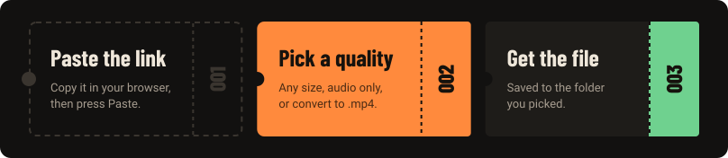

<p align="center">
  
</p>

<p align="center">
  A desktop app for macOS, Windows and Linux that drives <a href="https://github.com/yt-dlp/yt-dlp">yt-dlp</a> and <a href="https://ffmpeg.org">ffmpeg</a> for you.
</p>

<p align="center">
  <a href="https://github.com/kitsupanic/Grapplehook/releases/latest"><b>Download</b></a> ·
  <a href="#install">Install help</a> ·
  <a href="#build-from-source">Build from source</a> ·
  <a href="LICENSE">MIT license</a>
</p>

<p align="center">
  
</p>

## What it does

<p align="center">
  
</p>

- **Paste and go.** The paste button reads the link from your clipboard, and Grapplehook shows the video's thumbnail, title, uploader and length before you download.
- **Pick what you get.** Any available quality, audio only, a save folder and a file name. Optionally convert to `.mp4` and choose the quality (CRF) and encoding speed.
- **Watch it work.** Each download shows its stage (preparing, downloading, converting, done), percent, size, speed and time left. Run several at once and cancel any of them.
- **No terminal needed.** If yt-dlp or ffmpeg are missing, Grapplehook offers to download its own checksum-verified copies. If you already installed them yourself, it uses yours and never changes them. See [Tools](#tools).

> [!IMPORTANT]
> Downloading YouTube content is governed by YouTube's Terms of Service and by copyright law. Use this only for videos you have the right to download.

## Install

Get the installer for your platform from the [latest release](https://github.com/kitsupanic/Grapplehook/releases/latest):

| Platform              | File        |
| --------------------- | ----------- |
| macOS (Apple Silicon) | `.dmg`      |
| Windows               | `.exe`      |
| Linux                 | `.AppImage` |

On an Intel Mac, [build from source](#build-from-source).

The builds are **not code-signed**, so macOS and Windows show a warning the first time you open the app. That is expected and only happens once. Open your platform below for the steps. If you would rather not run an unsigned app, [build from source](#build-from-source) instead.

<details>
<summary><b>macOS</b>: "Apple cannot check it for malicious software"</summary>

<br>

Gatekeeper blocks the first launch with _"Grapplehook" cannot be opened because Apple cannot check it for malicious software_ (or _"the developer cannot be verified"_).

1. Open the `.dmg` and drag **Grapplehook** into **Applications**.
2. Try to open it once. It will be blocked; that is fine.
3. Go to **System Settings → Privacy & Security**, scroll down, click **Open Anyway** next to the Grapplehook message, and confirm.

On older macOS versions, right-click the app in Applications and choose **Open** (twice, if needed). After this it opens normally.

If macOS says the app _"is damaged and can't be opened"_, that is the quarantine flag macOS puts on unsigned downloads. Clear it with:

```bash
xattr -cr /Applications/Grapplehook.app
```

</details>

<details>
<summary><b>Windows</b>: "Windows protected your PC"</summary>

<br>

SmartScreen shows a blue **"Windows protected your PC"** dialog when you run the installer.

1. Click **More info**.
2. Click **Run anyway**.

Your browser may also flag the download itself: choose **Keep** / **Keep anyway** in the download bar.

</details>

<details>
<summary><b>Linux</b>: make the AppImage executable</summary>

<br>

No signing is involved. Make the file executable and run it:

```bash
chmod +x Grapplehook*.AppImage
./Grapplehook*.AppImage
```

If it fails with a FUSE error on newer distros (Ubuntu 24.04+), install `libfuse2` (for example `sudo apt install libfuse2t64`) or run it with `--appimage-extract-and-run`.

</details>

<details>
<summary><b>Verify your download</b> (optional)</summary>

<br>

Every release asset has its SHA-256 digest listed on the release page. Compare it with:

```bash
shasum -a 256 <file>               # macOS
sha256sum <file>                   # Linux
certutil -hashfile <file> SHA256   # Windows
```

</details>

### Updates

On launch, Grapplehook asks GitHub for the latest release. If a newer one exists, a small notice in the top bar links to it. If you are offline or GitHub rate-limits the request, nothing is shown.

## Tools

Grapplehook does not bundle the programs it runs; it calls them **Tools**. On first run it looks for them on your `PATH` (**System Tools**). Any required Tool that is missing can be downloaded by Grapplehook after you agree (**Managed Tools**). You can install, update or delete Managed Tools from the Tools sheet at any time. The same list is in the app's **About** panel.

| Tool    | Needed?                    | License    | Source                                                       |
| ------- | -------------------------- | ---------- | ------------------------------------------------------------ |
| yt-dlp  | Required                   | Unlicense  | [github.com/yt-dlp/yt-dlp](https://github.com/yt-dlp/yt-dlp) |
| ffmpeg  | Required                   | GPL builds | [ffmpeg.org](https://ffmpeg.org/download.html)               |
| ffprobe | Required                   | GPL builds | [ffmpeg.org](https://ffmpeg.org/download.html)               |
| aria2c  | Optional, faster downloads | GPLv2+     | [github.com/aria2/aria2](https://github.com/aria2/aria2)     |

ffmpeg needs a GPL build because the H.264 conversion uses `libx264`.

## Build from source

You need [Node.js](https://nodejs.org) 22+, [pnpm](https://pnpm.io), a [Rust toolchain](https://rustup.rs) and the [Tauri system prerequisites](https://tauri.app/start/prerequisites/) for your OS.

```sh
pnpm install
pnpm tauri dev        # run the app
pnpm tauri build      # produce an installer for your platform
```

Checks, as CI runs them:

```sh
pnpm lint && pnpm typecheck && pnpm test
cd src-tauri && cargo fmt --check && cargo clippy --all-targets -- -D warnings && cargo test
```

### Layout

Built with Tauri 2 (Rust) and Svelte 5.

- `src-tauri/src/core/`: the core module ([ADR-0001](docs/adr/0001-core-in-rust-cli-dropped.md)). Its public interface is the test seam; tests live in `src-tauri/tests/`.
- `src-tauri/src/commands.rs`: thin Tauri command layer over core.
- `src/`: Svelte frontend. It only calls commands and renders the result.

Tool terms (System Tool, Managed Tool, ...) are defined in [`GLOSSARY.md`](GLOSSARY.md); decisions are in [`docs/adr/`](docs/adr/).

## Contributing

See [CONTRIBUTING.md](CONTRIBUTING.md) and the [Code of Conduct](CODE_OF_CONDUCT.md). To report a security problem, follow [SECURITY.md](SECURITY.md).

## License

[MIT](LICENSE). Third-party Tools keep their own licenses, listed under [Tools](#tools).
